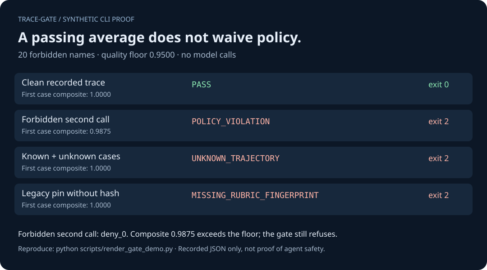

# trace-gate: regression checks for agent traces

**Check what an agent did, catch forbidden calls, and spot regressions before the next CI step.**

[](https://github.com/homayoun-safarpour/trace-gate/actions/workflows/ci.yml)


Give trace-gate a recorded JSON trace, a rubric describing your checks, and a
reviewed baseline. A forbidden tool call fails the check even when the average
score looks good. The Python core needs no runtime dependencies or model calls.

```bash
# From this reviewed checkout or extracted source archive:
python -m pip install .
trace-gate check examples/trajectories/support_regress.json --rubric examples/rubric.json --baseline examples/baselines/support_v1.json
```

```text
verdict: POLICY_VIOLATION
  rubric_sha256 OK (1d90a2ae91e6...)
  support-agent-good: POLICY_VIOLATION forbidden_tools_used=['delete_order'] (forbidden_tools=0.5000; tolerance does not apply)
```

The check exits **2**. The same command with `support_good.json` exits **0**.
`score` only prints diagnostics; use **`check`** as your CI gate.

> Prepared for **0.2.0**. The public CI badge does not validate a local archive.
> Check the exact revision and its CI results before deployment;
> [verify the installation](docs/INSTALLATION.md) and review the
> [0.2.0 changes and migration notes](docs/RELEASE_NOTES_0.2.0.md).

## A forbidden call fails even when the average passes



This illustration is generated from real CLI results on synthetic fixtures,
not a production benchmark or a competitor comparison. Reproduce it with
`python scripts/render_gate_demo.py`; the underlying results are in
[gate-proof.json](docs/gate-proof.json).

## Quickstart

### Is this useful for your project?

Use trace-gate when you already record agent tool calls and want a repeatable
check in CI. For example, a support agent might complete most of a task correctly
but call `delete_order`, which your policy forbids. That run should fail rather
than hide behind a high average score.

The check works on recorded evidence. It does not intercept a live agent or
stop a tool call before it happens. If you need that boundary, add a separate
runtime policy check around the executor.

### Try the example

Use Python 3.10+. The commands below do not invoke the recorded tools.

```bash
trace-gate score examples/trajectories/support_good.json --rubric examples/rubric.json

# Review the trace and rubric before writing or replacing a pin.
trace-gate freeze examples/trajectories/support_good.json \
  --rubric examples/rubric.json \
  --out baseline.json \
  --tolerance 0.05

trace-gate check examples/trajectories/support_good.json \
  --rubric examples/rubric.json \
  --baseline baseline.json
```

Expected final check:

```text
verdict: PASS
  rubric_sha256 OK (1d90a2ae91e6...)
  support-agent-good: PASS composite=1.0000 >= floor=0.9500 (pinned=1.0000)
```

Use `--json` with `score` or `check` for machine-readable results. A valid
`check` result contains `verdict`, `ok` and `details`. Input/file errors go to
stderr with exit 2, even with `--json`; see [exit codes](docs/EXIT_CODES.md).

## What the gate checks

1. **Supported input shape.** Every nested tool call is retained, including
   repeated calls. Malformed evidence is rejected before scoring.
2. **Rubric identity.** A baseline must contain the matching rubric SHA-256.
   Missing fingerprints require deliberate migration; they do not opt out.
3. **Hard policy.** Any observed forbidden tool vetoes `check` and `freeze`,
   regardless of the composite, tolerance or previously pinned score.
4. **Complete case coverage.** Supply each baseline case exactly once. Unknown,
   omitted or duplicate case names cannot be hidden by another passing case.
5. **Quality regression.** Every case must reach `pinned composite - tolerance`.
   The composite remains the mean of four diagnostic metrics: tool presence,
   forbidden tools, tool order and step count. Unconstrained metrics score 1.

A rubric fingerprint detects a mismatch. It is **not authentication** and does
not prevent someone from changing both the rubric and baseline. Review and
protect those files and the CI job that invokes this check.

[Gate and migration contract](docs/GATE_CONTRACT.md) ·
[Supported input format](docs/PARSER_CONTRACT.md) ·
[Claim boundaries](docs/RELIABILITY_CARD.md)

## Fit it into the tools you already use

Existing tests often omit agent traces. Pytest can inspect JSON too; trace-gate
provides a small ready-made scorer, reviewed baseline format and console gate.

| Tool | Where it fits |
| --- | --- |
| [Promptfoo](https://www.promptfoo.dev/) | Broader evaluation and red-team workflows, with existing CI thresholds and reports. Use its native gates when they cover your need. |
| [DeepEval](https://deepeval.com/docs/metrics-tool-permission) | Test-oriented evaluations, including deterministic tool permissions. Forbidden-tool detection is not unique to trace-gate. |
| [AgentEvals](https://github.com/langchain-ai/agentevals) | Rich trajectory matching, argument matching and optional LLM judges. Prefer it when those capabilities matter. |
| trace-gate | A small dependency-free check for supported JSON traces, rubric fingerprints, exact case coverage and pinned composite floors. |

No head-to-head accuracy, speed or adoption advantage has been measured. This
package does not provide an observability platform, runtime tool interception,
live OpenTelemetry collection, general OTLP conformance, argument checking or
semantic grading of replies. The narrow offline profile is described below.

## Optional Promptfoo integration

Use the [external Python assertion example](integrations/promptfoo/README.md) to
check a complete recorded suite inside Promptfoo. It includes a pinned offline
echo test, positive/negative fixtures, a native configured comparison, and
explicit warnings about outer thresholds overriding failures. The core runtime
remains dependency-free; Promptfoo is optional.

## CI integration

Install the reviewed wheel or source archive in your build, keep your rubric,
traces and baseline in the project, and run:

```bash
trace-gate check path/to/case-a.json path/to/case-b.json \
  --rubric rubric.json --baseline baseline.json
```

Exit **0** means the configured recorded-trace checks passed. Exit **2** means
refusal. Do not swallow the failure with `|| true` or `continue-on-error`.
For sharded CI, create a separately reviewed baseline per shard; partial suites
cannot pass against a full-suite pin.

With [agent-loop-engine](https://github.com/homayoun-safarpour/agent-loop-engine),
install both packages in the same environment, then run from this source root:

```bash
loop-engine tick --state integrations/loop-engine/LOOP_STATE.md \
  --journal /tmp/trace-gate-loop-demo-journal.md \
  --gate "trace=trace-gate check examples/trajectories/support_good.json --rubric examples/rubric.json --baseline examples/baselines/support_v1.json"
```

The bundled state is synthetic. Keep the journal separate from all inputs.
**A tick exits 0 even when its decision is `repair`.** Read its decision; use
`trace-gate check` directly when CI must fail on refusal. See the
[verified integration and command-safety notes](integrations/loop-engine/README.md).

## Limits and migration

- Recorded calls are evidence of attempted tool use, not proof of successful
  execution. This package neither executes nor prevents a live tool call.
- Structural validation cannot establish trace authenticity or completeness.
  Empty recorded traces can be appropriate if the rubric permits them.
- Checks use parsed case names. Legacy fallback from `name` to `id` to
  `unnamed` is retained; give every fixture an explicit stable name.
- Baseline schema v1 and composite arithmetic remain compatible. Gate behavior
  is intentionally stricter. Hashless baselines, partial case sets and
  policy-violating freezes that previously worked now fail.
- Baselines do not pin parser/scorer versions. Review old traces after parser
  upgrades, and deliberately re-freeze only when the new evidence is acceptable.
- A passing check is not a general safety guarantee or a deployment approval.

The [migration guide](docs/GATE_CONTRACT.md#legacy-baseline-migration) explains
how to review legacy pins without automatically blessing a failing run.
[Additional hardening notes](docs/CORE_HARDENING.md) describe stricter
JSON/policy validation and the new report-rubric binding for Python API users.
The private follow-up also [stages baseline writes](docs/BASELINE_WRITES.md)
before replacement so write failures do not truncate the reviewed pin.

## Development and evidence

[Build and test the real distribution](docs/INSTALLATION.md), including packaged
fixtures and a clean environment containing only the wheel. The CI configuration
targets Python 3.10–3.12; the accompanying retest report lists the exact
interpreters and results actually exercised. A configured matrix is not evidence
that hosted CI has run.

Central acceptance tests include:

- `test_forbidden_tool_veto_cannot_be_diluted`
- `test_known_case_does_not_hide_unknown_case`
- `test_omitting_a_baseline_case_fails_closed`
- `test_missing_fingerprint_is_not_legacy_success`
- `test_forbidden_freeze_never_creates_or_overwrites_pin`

## Attribution and related work

Trajectory-evaluation framing comes from **[langchain-ai/agentevals](https://github.com/langchain-ai/agentevals)** (MIT, Copyright LangChain et al.). This is a separate MIT implementation, not a full fork or a replacement for that project.

- [agent-loop-engine](https://github.com/homayoun-safarpour/agent-loop-engine): consumes exit codes as loop gates.
- [judge-drift-sentinel](https://github.com/homayoun-safarpour/judge-drift-sentinel): companion judge-reliability diagnostics.
- [judge-field-guide](https://github.com/homayoun-safarpour/judge-field-guide): map of the LLM-judge ecosystem.
- [Interview pack](docs/INTERVIEW.md): technical walkthrough.

Author: Homayoun Safarpour. [LinkedIn](https://www.linkedin.com/in/homayoun-safarpour/)

## License

MIT. See [LICENSE](LICENSE).

## Offline OpenTelemetry / OpenInference import

`inspect-otel` reads one OpenInference OTLP JSON trace and emits payload-minimized
evidence. `score` / `freeze` / `check` opt in with
`--input-format openinference-otlp --coverage declaration.json`. For a suite,
repeat `--coverage` once per export in matching order; every baseline case must
be supplied exactly once. Coverage defaults
to unknown and refuses scoring. This is a narrow, caller-attested profile, not
full OTLP support or proof of trace completeness. See the
[contract and synthetic demo](docs/OTEL_ADAPTER.md).

The optional [OpenTelemetry JavaScript compatibility check](integrations/opentelemetry-js/README.md)
creates synthetic spans with the real SDK, serializes them through its OTLP JSON
serializer and tests the installed trace-gate CLI. It checks one pinned runtime
without contacting a collector; it is not a claim of universal exporter support.
