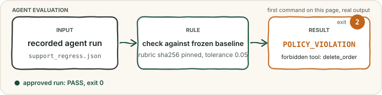

# trace-gate

**Unit tests pass while your agent starts calling forbidden tools, because pytest never reads the recorded run.**

[](https://github.com/homayoun-safarpour/trace-gate/actions/workflows/ci.yml)


Agent evaluation: fail CI when a recorded agent run calls a forbidden tool or its score regresses against a reviewed baseline (exit 0 or 2).

trace-gate is a small command-line check that reads the recorded run of an AI agent (its messages and tool calls) and compares it with a run that a person has already approved. We built it because a test suite checks the code of an agent, whereas the failures we care about appear in what the agent did during a run, such as calling a tool that the rules forbid. Given a rubric and a frozen baseline, trace-gate blocks any run that called a forbidden tool, scores the rest with fixed rules, keeps the sha256 fingerprint of the rubric beside the stored score, and returns exit 0 or 2, so that a CI job or an agent loop can stop a change that makes the agent worse.

```bash
git clone https://github.com/homayoun-safarpour/trace-gate
cd trace-gate && pip install -e .
trace-gate check examples/trajectories/support_regress.json --rubric examples/rubric.json --baseline examples/baselines/support_v1.json
```

```text
verdict: POLICY_VIOLATION
  rubric_sha256 OK (1d90a2ae91e6...)
  support-agent-good: POLICY_VIOLATION forbidden_tools_used=['delete_order'] (forbidden_tools=0.5000; tolerance does not apply)
```

That command exits 2. The same check on `examples/trajectories/support_good.json` exits 0.



[How it works](#how-it-works) · [Results](#what-each-result-means) · [Limits](#limits) · [Interview pack](docs/INTERVIEW.md) · [Cite](#citation) · Part of [a small open stack for checking AI agents and their judges](https://homayoun-safarpour.github.io)

## Use it in GitHub Actions

Add one step to a workflow. The job fails when the run breaks the rubric or is worse than the baseline, and the verdict appears in the job summary.

```yaml
- uses: actions/checkout@v4
- uses: homayoun-safarpour/trace-gate@main
  with:
    trajectory: runs/latest.json
    rubric: eval/rubric.json
    baseline: eval/baseline.json
```

The step has two outputs, `verdict` and `exit-code`. Pin a release tag or a commit SHA in place of `main` once a build depends on it. This repository tests the Action on every push: the approved example run must pass, and the run that calls a forbidden tool must be blocked.

## What each result means

Only `PASS` exits 0. Every other result exits 2, and a CI job should block on any exit that is not 0.

| Verdict | Exit | Meaning |
|---|---|---|
| `PASS` | 0 | Every run used only the tools the rubric allows, every case in the baseline was supplied once, and each score is within the tolerance of its pinned score. |
| `POLICY_VIOLATION` | 2 | A run called a tool listed in `forbidden_tools`. The tolerance does not apply, whatever the score. |
| `REGRESSION` | 2 | A score fell below the pinned score minus the tolerance. |
| `RUBRIC_DRIFT` | 2 | The rubric no longer matches the fingerprint stored with the baseline. |
| `MISSING_RUBRIC_FINGERPRINT` | 2 | The baseline has no rubric fingerprint, so it must be reviewed and frozen again. |
| `MISSING_BASELINE` | 2 | The baseline has no scores, so there is nothing to compare against. |
| `UNKNOWN_TRAJECTORY` | 2 | The name of a run, or of any one of several runs, is not in the baseline. |
| `MISSING_TRAJECTORY` | 2 | A case in the baseline was not supplied. |
| `DUPLICATE_TRAJECTORY` | 2 | A run name appears more than once. |
| `INVALID_BASELINE` | 2 | The baseline has an unsupported version, a malformed fingerprint, or a tolerance or score that is not a finite number between 0 and 1. |

A missing or unreadable file, invalid JSON or a malformed run or rubric also exits 2, with one `INVALID_TRAJECTORY`, `INVALID_RUBRIC` or `INVALID_BASELINE` line on stderr and no verdict. `freeze` refuses with one `FREEZE_REFUSED` line, exit 2, and writes no file, also when the run called a forbidden tool.

A `PASS` shows that the recorded tool use matches the reviewed rubric and has not become worse. It does not show that the reply was correct or helpful. The exit contract is in [`docs/EXIT_CODES.md`](docs/EXIT_CODES.md), and the limits of each claim are in [`docs/RELIABILITY_CARD.md`](docs/RELIABILITY_CARD.md).

## Use this when

| Situation | Use trace-gate? |
| --- | --- |
| Your agent's runs are exported as JSON (messages and tool calls) and you want a CI check | Yes |
| You need exit code `0` or `2` so GitHub Actions or [agent-loop-engine](https://github.com/homayoun-safarpour/agent-loop-engine) can stop on failure | Yes |
| You want a language-model judge to grade the run | No. Use [langchain-ai/agentevals](https://github.com/langchain-ai/agentevals); this tool uses fixed rules only |
| Your traces are OpenInference OTLP JSON exports | Yes, offline, with one coverage declaration per export. See [`docs/OTEL_ADAPTER.md`](docs/OTEL_ADAPTER.md) |
| Your traces are in another OpenTelemetry or Jaeger format | Not directly. Convert them to JSON first |
| You need to stop a tool call while the agent is running | No. This checks recorded runs after the fact |

The package is not on PyPI yet. `pip install git+https://github.com/homayoun-safarpour/trace-gate` is the other way to install it. Its PyPI name will be `agent-trace-gate`, because PyPI counts `trace-gate` as the same name as an existing project. In Python code the package is imported as `trace_gate`. Version 0.2.0 changes are in [`docs/RELEASE_NOTES_0.2.0.md`](docs/RELEASE_NOTES_0.2.0.md).

## The problem

An evaluation library can score one run. A build needs a different answer: did this change make the agent worse than the last approved run? Without a pinned baseline, a score is a single number that nothing can gate on. An average score can also hide one forbidden call, so a forbidden tool has to block the run by itself. Without a fingerprint of the rubric, a teammate can make a failing agent pass by deleting a forbidden tool from the rubric file.

## How it works



1. `trace-gate score` reads a run and scores it against the rubric. It only prints diagnostics and exits 0 even when `policy_ok=false`, so it is not the gate.
2. `trace-gate freeze` stores the score of an approved run as the baseline, with a tolerance and the sha256 fingerprint of the rubric. It refuses a run that called a forbidden tool.
3. `trace-gate check` checks each new run in order: rubric fingerprint, forbidden tools, that every baseline case is supplied exactly once, then each score against its floor. It exits 0 only on `PASS`.

```bash
trace-gate score examples/trajectories/support_good.json --rubric examples/rubric.json

trace-gate freeze examples/trajectories/support_good.json \
  --rubric examples/rubric.json \
  --out baseline.json \
  --tolerance 0.05

trace-gate check examples/trajectories/support_good.json \
  --rubric examples/rubric.json \
  --baseline baseline.json
```

Output of the last command, on the approved run:

```text
verdict: PASS
  rubric_sha256 OK (1d90a2ae91e6...)
  support-agent-good: PASS composite=1.0000 >= floor=0.9500 (pinned=1.0000)
```

Add `--json` to `score` or `check` for machine-readable output.

| Module | What it does |
|---|---|
| `trace_gate.trajectory` | Loads a run from JSON, rejects malformed runs, and extracts every tool call, including every entry of a `tool_calls` list |
| `trace_gate.score` | Scores the run against the rubric with fixed rules and no model calls, and lists any forbidden tools it called |
| `trace_gate.baseline` | Freezes, loads and checks a baseline together with the rubric fingerprint |
| `trace_gate.otel` | Reads one offline OpenInference OTLP JSON export (`trace-gate inspect-otel`) |
| `trace_gate.cli` | The `score`, `freeze`, `check` and `inspect-otel` commands |

Interview pack: [docs/INTERVIEW.md](docs/INTERVIEW.md), three questions and a two-minute demo. Gate order and baseline migration: [`docs/GATE_CONTRACT.md`](docs/GATE_CONTRACT.md). Input format: [`docs/PARSER_CONTRACT.md`](docs/PARSER_CONTRACT.md).

## Limits

- It is not a language-model judge. It scores tool use only and does not judge the meaning of a reply or check tool arguments.
- A recorded call is evidence that a tool was called, not that it succeeded. trace-gate neither runs nor stops a live tool call.
- The run format is minimal. Tool calls are read from `tool`, from every entry of `tool_calls`, and from `name` only on a step with no `role` or `type`, or on a `tool_use` or `function_call` step. A `name` on a user, assistant or tool-result message is the speaker's name, not a call. Other trace formats need a converter first.
- A baseline is keyed by the run's name. If a run is renamed and the baseline is not updated, the verdict is `UNKNOWN_TRAJECTORY`. A partial set of cases cannot pass against a full baseline, so sharded CI needs one reviewed baseline per shard.
- The fingerprint detects a changed rubric. It is not authentication: someone who changes both the rubric and the baseline can still change the result, so review and protect those files.
- Baselines made by 0.1.0 without a fingerprint now fail as `MISSING_RUBRIC_FINGERPRINT`. Baselines do not pin the parser or scorer version, so review old runs after an upgrade before freezing again.
- It has no runtime dependencies and needs Python 3.10 or later. Every central claim has a named test under `tests/`.

## Use it as a gate in a loop

[agent-loop-engine](https://github.com/homayoun-safarpour/agent-loop-engine) can run this check before it lets an agent continue. A failed gate makes the loop repair before it adds new work. A tick exits 0 even when its decision is `repair`, so read its decision, and use `trace-gate check` directly when CI must fail.

```bash
loop-engine tick --state integrations/loop-engine/LOOP_STATE.md \
  --journal /tmp/trace-gate-loop-demo-journal.md \
  --gate "trace=trace-gate check examples/trajectories/support_good.json --rubric examples/rubric.json --baseline examples/baselines/support_v1.json"
```

## How we did it

1. **Chose the upstream.** [langchain-ai/agentevals](https://github.com/langchain-ai/agentevals) (MIT) showed that teams want to evaluate whole agent runs. Forking its full monorepo (Python, JavaScript and LangChain) would break the aim of an install in under 30 minutes.
2. **Built one small tool.** The MIT package `trace-gate` takes JSON in, scores it with fixed rules, makes no model calls, and has a command line shaped like the rest of this stack.
3. **Added two gates.** A frozen baseline with exit `0` or `2`, and a `rubric_sha256` pin, so that the criteria cannot change under the gate without a deliberate new freeze. Named tests: `test_check_detects_regression_below_floor`, `test_check_refuses_when_rubric_fingerprint_mismatches`.
4. **Made 0.2.0 fail closed.** A forbidden call vetoes the run whatever its score, every baseline case must be supplied once, and malformed input is refused before scoring. Named tests: `test_forbidden_tool_veto_cannot_be_diluted`, `test_known_case_does_not_hide_unknown_case`, `test_missing_fingerprint_is_not_legacy_success`, and the 33 cases of the 25 Nov 2026 code review in `tests/test_fail_closed.py`. The first screen of this README is checked against the real command by `tests/test_readme.py`.

## Related tools

- [agent-loop-engine](https://github.com/homayoun-safarpour/agent-loop-engine): state, gates, the next-step decision and a journal for agent loops.
- [judge-drift-sentinel](https://github.com/homayoun-safarpour/judge-drift-sentinel): tells a change in the system from a change in the judge.
- [judge-field-guide](https://github.com/homayoun-safarpour/judge-field-guide): a link-checked map of tools for language-model judges.

## Credit

The idea of evaluating a whole agent run comes from **[langchain-ai/agentevals](https://github.com/langchain-ai/agentevals)** (MIT, Copyright LangChain and contributors). trace-gate is a separate MIT tool with a smaller surface and no LangChain dependency, and it adds the frozen baseline, the forbidden-tool veto and the rubric fingerprint. Use agentevals for language-model judges, and trace-gate for the CI pin.

## Citation

Use the "Cite this repository" button on GitHub, or:

```bibtex
@software{safarpour2026tracegate,
  author = {Homayoun Safarpour},
  title  = {trace-gate: gate deploys on frozen agent-trajectory baselines},
  year   = {2026},
  url    = {https://github.com/homayoun-safarpour/trace-gate}
}
```

Author: Homayoun Safarpour. [LinkedIn](https://www.linkedin.com/in/homayoun-safarpour/)

## License

MIT. See [`LICENSE`](LICENSE).
